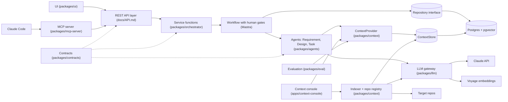
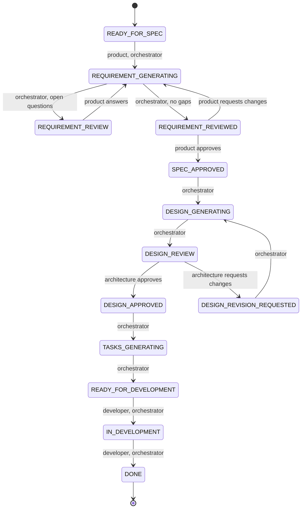
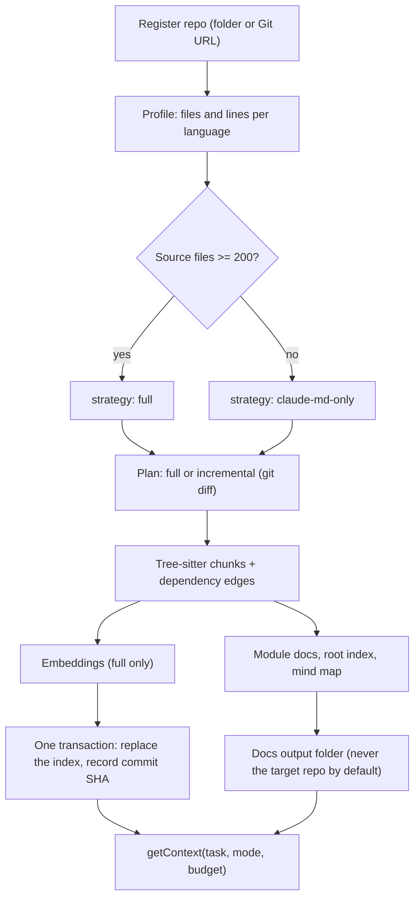

# Architecture

AI agents turn a business requirement into approved `requirements.md`, `design.md` and `tasks.md`, with a human approval gate between each, and the approved spec is handed to Claude Code through an MCP server. Agents propose; the orchestrator moves the status; humans approve.

## Components

Built today: `contracts`, `llm`, `context` (indexer, registry, provider), the context console and the retrieval harness in `eval`. Not built yet: `orchestrator`, `agents`, the REST layer, `ui`, `mcp-server` (see [TASKS.md](TASKS.md)).

## Initiative status machine

Source of truth: `packages/contracts/src/state-machine.ts`. Every transition names who may trigger it; there is no "agent" actor.

The two human gates are `REQUIREMENT_REVIEW`/`REQUIREMENT_REVIEWED` (Product) and `DESIGN_REVIEW` (Architecture). The workflow suspends at each and resumes only on an explicit decision, never because of a comment.

## Case A and Case B

|                  | Case A: new product                  | Case B: existing repo                                           |
| ---------------- | ------------------------------------ | --------------------------------------------------------------- |
| Context provider | `NullContextProvider` (empty bundle) | `RepoContextProvider`                                           |
| Design Agent     | proposes the structure               | must cite real files and modules, checked by the grounding step |
| Retrieval        | none                                 | `claude-md`, `embeddings` or `hybrid`, under `budgetTokens`     |

## Context Agent (what exists)

## Where each rule is enforced

| Rule                                       | Where                                                            |
| ------------------------------------------ | ---------------------------------------------------------------- |
| Agents cannot change status                | no `agent` actor in `ACTORS`; `assertTransition`                 |
| Only Product approves requirements         | `TRANSITION_RULES` (`REQUIREMENT_REVIEWED` → `SPEC_APPROVED`)    |
| Only Architecture approves designs         | `TRANSITION_RULES` (`DESIGN_REVIEW` → `DESIGN_APPROVED`)         |
| API cannot drift from the contracts        | `docs/API.md` is generated; `pnpm docs:api:check` fails on drift |
| Untrusted text cannot act as instructions  | `wrapUntrusted` in `@sdd/llm`                                    |
| Cost is recorded for every model call      | `AgentRun` via `toAgentRun`, one per billed call                 |
| A failed index never leaves a half-index   | transactional `replaceIndex` in `ContextStore`                   |
| Generated docs never overwrite a real file | `DocsOutput` writes to its own folder; `publishToRepo` is opt-in |

See [DECISIONS.md](DECISIONS.md) for the reasoning, [API.md](API.md) for the endpoints and [CONTEXT-SCHEMA.md](CONTEXT-SCHEMA.md) for the context tables.
